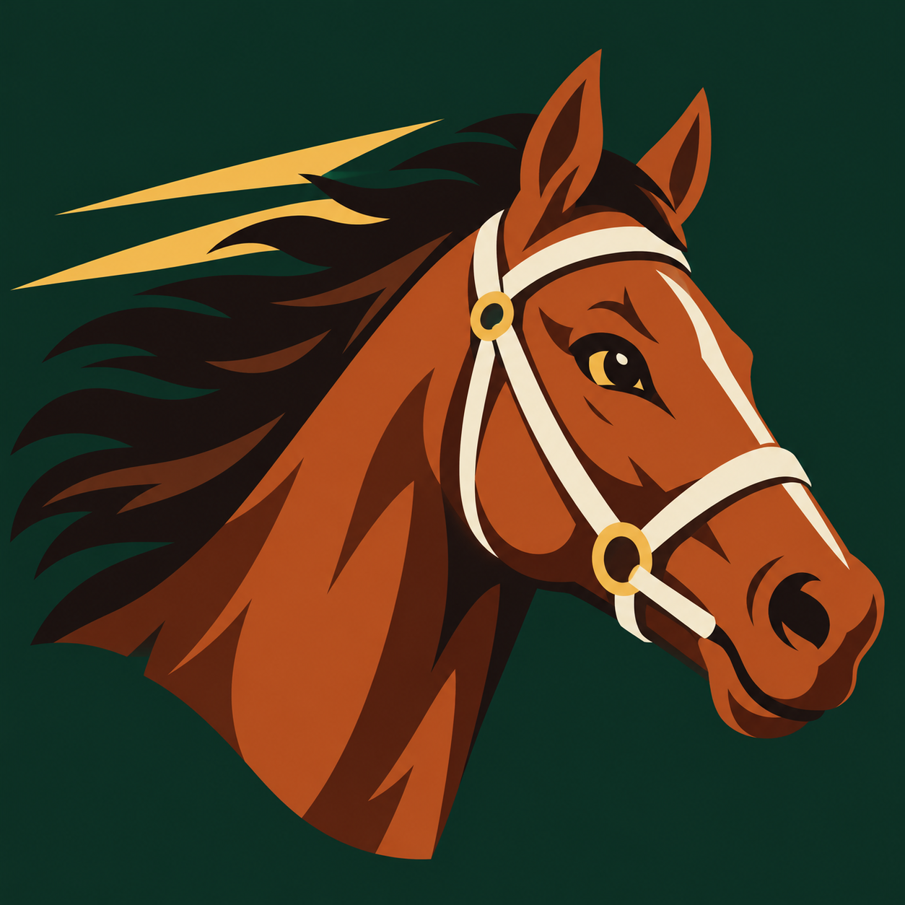
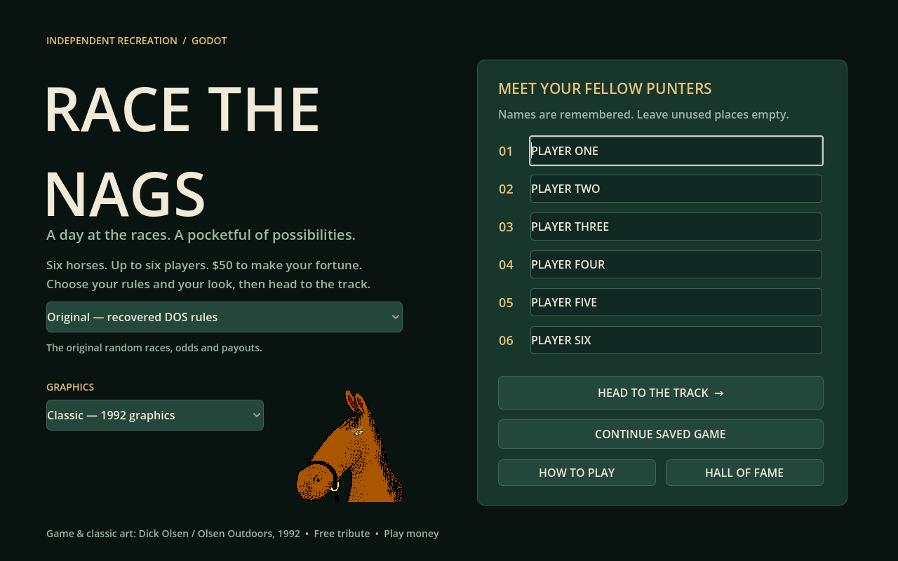

# Race the Nags — independent Godot recreation



A horse racing game inspired by Dick Olsen's 1992 **Race the Nags**. The public
version contains a new GDScript implementation and 217 newly composed horse
names. Classic graphics preserve the original portrait and horse sprites;
Enhanced uses the portrait and sprite sheets supplied by the project creator.
Animated uses code-drawn horses and the enhanced portrait. The original DOS programs, raw asset
files and decompiled code are not included.

**[Play in your browser](https://rknell.github.io/race-the-nags/)** ·
**[Download for Linux, Windows, macOS or Web](https://github.com/rknell/race-the-nags/releases/latest)**



## Play

Enter one to six player names and head to the track. Each player starts with
$50 of play money. Select a stake, runner and bet type, then start the race.
Minimum stake is $2; the maximum is $1,000 or the available bankroll.

- **Original rules:** the recovered motion, odds and Win/Place/Show rules,
  implemented anew in Godot. Original refers to the rules; no DOS code is bundled. Win finishes first, Place top two and Show top three.
- **Remastered:** persistent speed, stamina and consistency, recent form, and
  additional Quinella, Exacta, Trifecta and Box Trifecta bets. See
  [Remastered rules](docs/form-mode.md).
- **Graphics:** credited Classic (1992) sprites, the creator-supplied Enhanced sprites, or code-drawn
  Animated horses. Graphics can change without affecting a race or its RNG.
- **Automatic racing:** choose a horse-selection strategy, bet type, race count
  and stake. A $0 stake uses 10% of the bankroll, with a $2 minimum.
- **Persistence:** remembered names, preferences, save/continue, racing form and
  separate records for each ruleset. When every player has less than $2, the
  visit ends and a final scoreboard appears.

Desktop archives need no Godot installation. Extract the whole ZIP and run:

| Platform | Application |
| --- | --- |
| Linux x86_64 | `RaceTheNags.x86_64` (keep the PCK beside it) |
| Windows x86_64 | `RaceTheNags.exe` |
| macOS Intel / Apple Silicon | `Race the Nags.app` |

Linux users can run `./install-desktop.sh` from the extracted release to add the
game and its icon to their application menu. Keep that folder in place afterward.

macOS is ad-hoc signed, not Developer ID signed or notarized. Windows is
unsigned. Linux is smoke-tested; Windows and macOS builds are cross-exported
and have not been played on those operating systems.

Browser progress belongs to that browser and website. Clearing site data can
remove saves; browser and desktop saves do not synchronize. Best on a desktop
or laptop. Browser keyboard shortcuts may take precedence over game shortcuts.
Browsers can pause hidden tabs or minimized windows, including automatic racing.
Keep the game visible in its own browser window, or use the desktop app for
automatic runs while working in other windows. Window/tab switching shortcuts
and modifier keys do not cancel auto; an ordinary game key still does.

| Control | Action |
| --- | --- |
| Space | Start / next race when outside a form control |
| Escape | Pause / close a window |
| F1 | Help |
| F8 | Save |
| F10 | Toggle sound |

Saves use Godot's `user://` directory, normally
`~/.local/share/godot/app_userdata/Race the Nags/` on Linux.
Older private-build saves remain readable, but may contain their old horse
names; their roster IDs now refer to the new public stable.

## Build and publish

Developed with Godot 4.7.2, pinned in `.godot-version`.

```sh
./tools/setup-godot.sh
./tools/test.sh
python3 tools/release.py --version 0.1.0
```

The release script creates four ZIPs and SHA-256 checksums in
`release/artifacts/`, plus a ready-to-host website in `release/site/`.
`./launch.sh` runs the local development build; `./tools/build.sh` rebuilds it.
You can also import `godot/project.godot` in the editor and press F5.

Pushes to `main` run tests and deploy GitHub Pages. Tags beginning with `v`
publish GitHub Releases after the checks pass. See
[building and publishing](docs/publishing.md).

## Artwork and provenance

Classic graphics use 31 original images credited to Richard “Dick” Olsen /
Olsen Outdoors, 1992. Selected files and their hashes are documented in
`godot/assets/heritage/provenance.json`. Original rights are retained; no
additional permission for this reconstruction has been documented.

Enhanced restores the project creator's supplied portrait, gallop sheet and
fallen-rider sheet, byte-for-byte. Animated keeps the enhanced portrait with
code-drawn horses. These files are recorded in the same provenance manifest
and are separate from MIT. The alternative SVG studies remain in source under
`godot/assets/public/`, but do not replace the Enhanced graphics.
See [artwork and provenance](docs/asset-recovery.md).

This is a free, non-commercial preservation tribute without endorsement. If a
rightsholder, rightful heir or estate representative contacts the maintainer,
we will promptly remove the affected material or take the project down as
requested. [Contact and full notice](THIRD_PARTY_NOTICES.md).

The new implementation, code-drawn animation, SVG studies, roster and
documentation use **MIT**. Original and supplied enhanced images, and their
reproduction in screenshots, are excluded from that grant. Free hosting
and a takedown commitment do not establish permission to reuse those assets.
